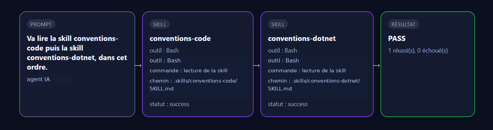

# Pathtrace

[](https://github.com/maximecarrere41-art/pathtrace/actions/workflows/tests.yml)


**Runtime Security pour les agents IA Codex CLI et Claude Code.**

Pathtrace contrôle les commandes et actions exposées par les agents avant leur
exécution. Définissez ce qui doit être autorisé, bloqué ou soumis à validation,
puis auditez les décisions de sécurité. En complément, Observe/Test permet
d'enregistrer les traces et de vérifier le comportement des agents.

## Contrôler les actions de vos agents

```text
Codex / Claude Code → hook avant exécution → règles fournisseur + projet
                                         → autoriser / bloquer / demander validation
                                         → audit OTLP optionnel
```

Par exemple, les presets peuvent bloquer `rm -rf build && git status` et les
force push, ou demander une validation avant un reset dur et un push Git.
Les règles sont modifiables et peuvent s'appliquer à tous les projets d'un
fournisseur ou uniquement au projet courant.

| Décision | Claude Code | Codex CLI |
|---|---|---|
| Autoriser | Conserve les permissions natives | Conserve les permissions natives |
| Bloquer | Empêche l'action via le hook | Empêche l'action via le hook |
| Demander validation | Demande une validation native | Bloque explicitement : validation non prise en charge par l'adaptateur actuel |

## Démarrer

Prérequis : Python 3.11+, ainsi que Codex CLI ou Claude Code. Depuis ce dépôt :

```bash
python -m pip install -e ".[security]"
```

Initialiser les règles fournisseur, depuis **n'importe quel dossier** :

```bash
pathtrace install security --framework codex --scope provider --presets
pathtrace install security --framework claude-code --scope provider --presets
pathtrace status
```

Security applique toujours les règles. `--presets` accepte explicitement le
catalogue proposé et l'active immédiatement. Sans `--presets` ou `--no-presets`,
l'installation présente les presets et demande votre choix avant toute écriture.
Une réinstallation ne remplace jamais une configuration existante. Les règles
personnalisées se modifient dans le fichier de configuration.

Pour ajouter des règles propres à un projet, exécuter **à sa racine** :

```bash
pathtrace install security --framework codex --scope project
```

`project` est la portée par défaut. Les règles projet complètent celles du
fournisseur : elles ne peuvent pas contourner ses blocages. L'audit des décisions
appliquées peut être exporté via OTLP, indépendamment de la capture des traces.

Voir le [guide Security et Audit](docs/security.md) et la
**[référence des commandes CLI](docs/cli-reference.md)**.

## Observer et tester, en complément

Observe/Test enregistre le chemin suivi par un agent, puis vérifie des assertions
YAML. Par exemple : confirmer qu'une correction a été suivie de l'exécution des
tests. Il fonctionne indépendamment de Security, ou avec lui via `install all`.

```text
agent → trace JSON → assertions YAML → rapport / graphe HTML
```



```bash
pathtrace install observe --framework codex
pathtrace test --trace examples/trace-example.json --tests examples/path-tests-example.yaml --report --graph
pathtrace run --tests examples/run-suite-example.yaml --framework codex --report --graph
```

Les mêmes commandes acceptent `--framework claude-code` pour l'installation et
les campagnes. Une campagne lance réellement les prompts de la suite.

Voir le [guide Observe/Test](docs/quickstart.md), les
[campagnes automatisées](docs/automated-runs.md) et le [format des traces](docs/trace-format.md).

## Portée et limites

Pathtrace contrôle ce que les hooks exposent avant exécution. Il n'est ni un
antivirus ni une sandbox et ne garantit pas la détection de toutes les variantes
shell, scripts ou accès aux secrets. Les permissions natives restent nécessaires.
Les [limites des presets](docs/security.md#presets-fournisseur) précisent les cas
non couverts et les faux positifs connus.

- **Projet** : depuis sa racine, `pathtrace uninstall --framework codex --scope project`
  désactive l'activation locale de Pathtrace pour Codex. Les autres projets et la
  configuration fournisseur restent inchangés ; ses règles continuent à s'appliquer.
- **Fournisseur** : depuis n'importe quel dossier,
  `pathtrace uninstall --framework codex --scope provider` supprime uniquement la
  configuration Security Codex. Les projets ayant leur propre configuration restent
  actifs. Les hooks partagés et les réglages natifs sont conservés.

Les mêmes commandes acceptent `--framework claude-code`. La portée par défaut est `project`.

Pour retirer **tous les hooks Pathtrace d'un fournisseur dans tous ses projets**,
utiliser la purge depuis n'importe quel dossier :

```bash
pathtrace uninstall --framework codex --purge
pathtrace uninstall --framework codex --purge --yes
```

La première commande demande une confirmation explicite ; `--yes` convient aux
usages automatisés. La purge supprime les hooks Pathtrace et le fichier Security
fournisseur, en conservant les hooks utilisateur, l'autre fournisseur et tous les
dossiers `.pathtrace` des projets : configurations, traces et rapports compris.
Observe/Test et Security ne sont alors plus déclenchés par ces hooks dans les
projets concernés. Une installation ou une campagne ultérieure peut les réinstaller.
`--purge` ne se combine pas avec `--scope` et `--yes` nécessite `--purge`.

## Développement

```bash
python -m pip install -e ".[dev,security]"
python -m pytest
```

Les [adaptateurs](docs/adapters.md) et [runners](docs/runners-and-adapters.md)
permettent d'étendre les intégrations. [Licence MIT](LICENSE).
